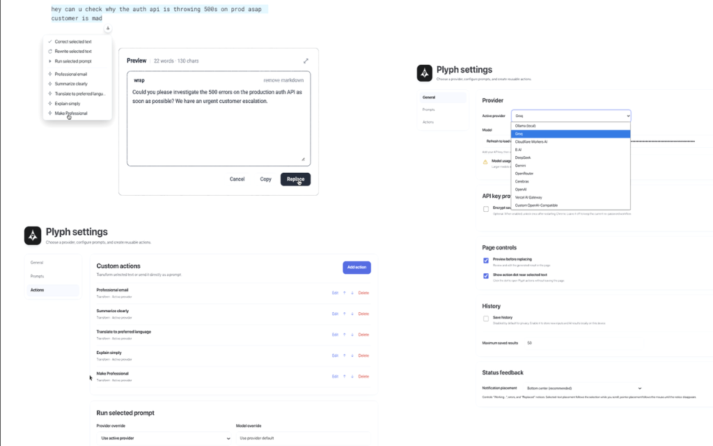

# Plyph for Chrome

  <strong>Use AI on selected text directly in Chrome.</strong> Correct grammar, polish writing, rewrite phrasing, run custom prompts, and transform text in place.

  
  
  
  

  

---

## Key Features

- **Multiple AI Providers** — Connect to local Ollama, your **ChatGPT Account**, Groq, DeepSeek, Gemini, OpenAI, OpenRouter, Cerebras, Cloudflare Workers AI, B.AI, Vercel AI Gateway, or any **Custom OpenAI-Compatible** endpoint.
- **Model Discovery** — Automatically discover models from configured endpoints or type any model name manually.
- **Output Format Controls** — Choose between `Auto` (smart Markdown preservation), strict `Plain text`, or explicit `Markdown` output.
- **Compact Preview & Editor** — Review and edit generated text before replacing, with a word-level changes view, line-wrapping toggle, and an expandable wide view. Markdown shape follows each action's output format instead of manual cleanup.
- **Flexible Triggering** — Access Plyph via the floating selection button, right-click context menu, toolbar popup, or custom keyboard shortcuts.
- **Custom Actions** — Build and save reusable prompt templates with custom variables, provider overrides, and token limits.
- **Local-First Privacy** — Credentials and history are stored locally in Chrome storage with optional password-based vault encryption. Zero analytics or tracking.

---

## Installation

### From the Chrome Web Store (Recommended)

Install directly from the [**Chrome Web Store**](https://chromewebstore.google.com/detail/plyph/oofbibaakbobdiidfockjbokcdajmeep).

### Manual / Developer Installation

1. Clone or download this repository.
2. Navigate to `chrome://extensions` in Google Chrome.
3. Enable **Developer mode** in the top-right corner.
4. Click **Load unpacked** and select the `Plyph-Chrome` folder.
5. Open Plyph settings, pick your preferred AI provider, and enter your API key or local Ollama URL.

---

## How to Use

1. **Select any text** on a webpage or inside an editable field (`<input>`, `<textarea>`, contenteditable).
2. **Choose an action** from:
   - The floating toolbar beside the selection (up to four configurable quick actions, plus More)
   - Right-click context menu (**Plyph → Action**)
   - Toolbar popup icon
   - Keyboard shortcuts (`Alt+Shift+C` to correct, `Alt+Shift+R` to rewrite)
3. **Preview & Replace**: Review the generated result in the compact dialog, make edits, and press **Replace** (`Ctrl+Enter` / `⌘Enter`) to insert it directly.

---

The floating button appears after a mouse or keyboard selection. It stays near the selected line, opens actions on click, and avoids nearby page controls. Click elsewhere, type, press Esc, or scroll to dismiss it. Select text again to bring it back. If there is no clear space beside the selection, use the right-click menu or a keyboard shortcut.

## Default Keyboard Shortcuts

| Shortcut                                          | Action                          |
| :------------------------------------------------ | :------------------------------ |
| <kbd>Alt</kbd> + <kbd>Shift</kbd> + <kbd>C</kbd>  | Correct selected text           |
| <kbd>Alt</kbd> + <kbd>Shift</kbd> + <kbd>R</kbd>  | Rewrite selected text           |
| <kbd>Ctrl</kbd> / <kbd>⌘</kbd> + <kbd>Enter</kbd> | Replace selection from Preview  |
| <kbd>Esc</kbd>                                    | Dismiss Preview or floating dot |

> Shortcuts can be customized anytime at `chrome://extensions/shortcuts`.

---

## Privacy & Security

- **User-Initiated Only**: Text is sent to your chosen AI provider only when you explicitly execute an action.
- **Local Storage**: API keys are saved locally in Chrome's `storage.local`. Optional password encryption keeps unlocked keys in memory-only `storage.session` until the browser closes.
- **Local AI Support**: When using a locally running Ollama or localhost server, your data never leaves your machine.
- **No Telemetry**: Plyph contains zero analytics, tracking scripts, or background telemetry.

### Ask about selected text

Select text, open the floating toolbar, and choose **Ask**. Enter an instruction or question and press **Send** (or Ctrl/Cmd+Enter). Ask is also available in the extension popup, right-click menu, and Chrome shortcut settings. It uses your active provider and existing result-preview setting.

### ChatGPT sign-in

Use your ChatGPT plan directly in Plyph without an API key.

1. Open Plyph settings and choose **ChatGPT Account** as the active provider.
2. Click **Continue with ChatGPT** and finish signing in through the sign-in window that opens.
3. Return to Plyph settings and click **Refresh** to choose a model.
4. Select text and run an action as usual.

You can add and switch between saved accounts, or sign out in settings. Access tokens refresh automatically, and credentials never leave Chrome storage.

Requests use your shared ChatGPT allowance. Open **Manage usage** to review usage and account access. Available models depend on your account.

For ChatGPT actions, set the output token limit to **Auto**. Explicit output token limits are not supported.
